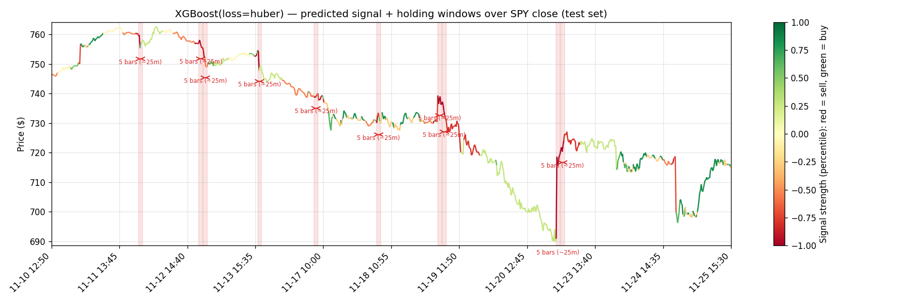

# CNN SPY Forecast

Predicts short-term SPY price direction from intraday data, and shows it as a buy/short signal
painted on the price chart.


*Green = predicted up (long), red = predicted down (short). Arrows mark example trades and their
~25-minute holding window.*

## How it works

1. **Data** — SPY 5-min candles via `yfinance`.
2. **Features** — momentum, volatility, volume, time-of-day — each one a pluggable class.
3. **Split** — chronological train/val/test, with a gap between them so no information leaks
   across the boundary.
4. **Models** — Ridge, XGBoost, and a CNN+GRU, compared head-to-head.
5. **Evaluation** — Information Coefficient (IC) and hit rate on unseen test data.

## Results

| Model | Hit rate | Spearman IC |
|---|---|---|
| Ridge | 47.1% | -0.040 |
| XGBoost | **54.4%** | **0.107** |
| CNN+GRU | 52.7% | 0.068 |

XGBoost currently wins. The deep model needs more training data to catch up.

## Project layout

```
src/features/   feature engine — each feature is its own class
src/models.py   Ridge / XGBoost / CNN+GRU, one shared interface
notebooks/      01 features -> 02 split -> 03-04 train -> 05 results -> 06 ablation -> 07 CNN+GRU
```

## Not built yet

- A C version of the feature engine for speed (spec: [`quantitative_time_series_prediction_c_feature_engine_spec.md`](quantitative_time_series_prediction_c_feature_engine_spec.md))
- A full backtest with trading costs
- Position sizing (currently just buy/short, not "how much")

## Run it

```
pip install -r requirements.txt
```

Then run the notebooks in order, `01` through `07`.
