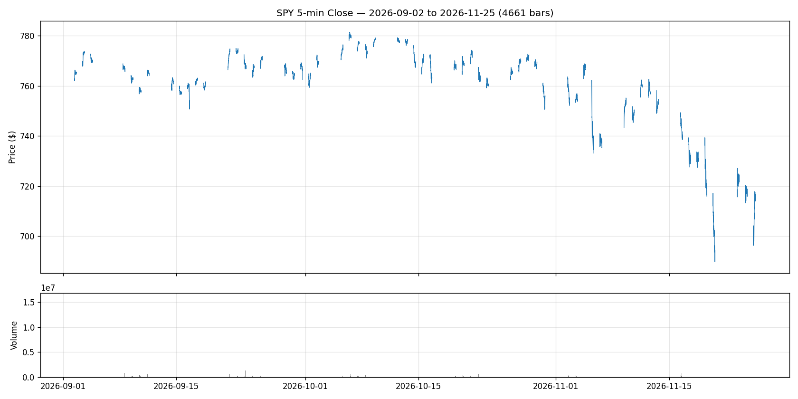
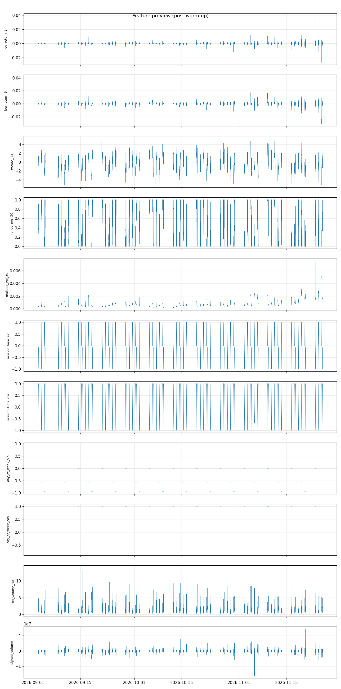

# Quant Time-Series Forecasting Pipeline

A from-scratch research pipeline that predicts short-horizon forward returns on SPY intraday
price data — built the way a quant research team actually iterates: modular feature engineering,
leakage-free validation, and systematic model comparison, instead of one notebook with a model
fit at the bottom.



## What it does

1. **Pulls data** — SPY 5-min OHLCV bars via `yfinance`, filtered to regular market hours.
2. **Builds features** — an OOP feature engine (Strategy + Registry pattern): momentum,
   mean-reversion (z-score, range position), realized volatility, order flow (relative/signed
   volume), and cyclical time-of-day/day-of-week encodings. Every feature is strictly causal, no
   lookahead.
3. **Builds a leakage-safe dataset** — chronological train/val/test split (70/10/20) with a
   **purged embargo gap** at each boundary so no feature window or target ever straddles two
   splits. Scaling is fit on train only.
4. **Trains three model tiers** behind one shared interface: Ridge, XGBoost, and a 1D-CNN+GRU
   deep model, all with a selectable loss (squared/MAE/Huber).
5. **Evaluates like a quant shop would** — out-of-sample Pearson/Spearman Information Coefficient
   and hit rate, not accuracy/RMSE.



## Results (current run, held-out test set)

| Model | Pearson IC | Spearman IC | Hit rate |
|---|---|---|---|
| Ridge | 0.042 | -0.040 | 47.1% |
| XGBoost | 0.060 | **0.107** | **54.4%** |
| CNN+GRU | **0.080** | 0.068 | 52.7% |

XGBoost still leads on rank-based IC and hit rate; the CNN+GRU edges ahead on linear correlation.
With ~3,200 training rows, that's roughly what you'd expect — deep models need more data to pull
ahead of gradient-boosted trees on this kind of tabular/sequential signal. A feature-ablation
study (`notebooks/06`) also found that feature value is model-dependent: calendar/time-of-day
features help XGBoost but hurt Ridge.

## Project layout

```
src/features/     feature engine (Strategy + Registry pattern, each feature is its own class)
src/dataset.py    leakage-safe split + scaling
src/models.py     Ridge / XGBoost / CNN+GRU behind a common interface
src/metrics.py    Pearson/Spearman IC, hit rate
notebooks/        01 dataset+features -> 02 split -> 03 models -> 04 training
                  -> 05 visualization -> 06 feature ablation -> 07 CNN+GRU
```

## Not yet built

- **C feature-computation engine** — O(N) rolling features via circular buffers + Welford's
  online variance, exposed to Python via ctypes, benchmarked against pandas. Fully specified in
  [`quantitative_time_series_prediction_c_feature_engine_spec.md`](quantitative_time_series_prediction_c_feature_engine_spec.md),
  not yet implemented.
- **Transaction-cost-adjusted backtest** — Sharpe, max drawdown, turnover, PnL vs. buy-and-hold.
- **Confidence-weighted position sizing** (currently binary enter/exit at a fixed horizon).

## Setup

```
pip install -r requirements.txt
```

Then run the notebooks in order (`01` through `07`) — each regenerates the data/model artifacts
that are gitignored here.
